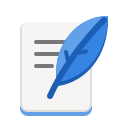
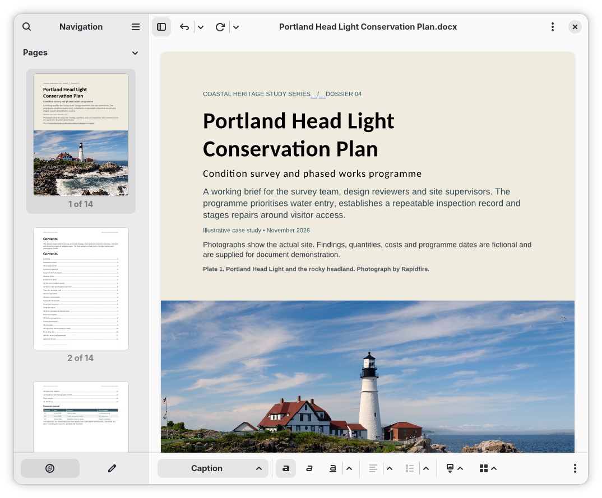
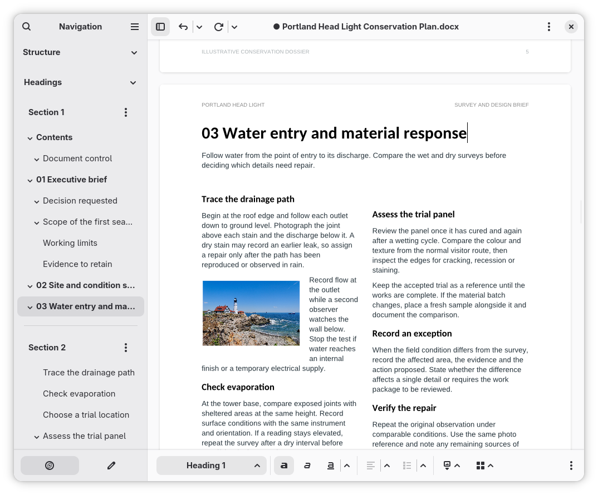
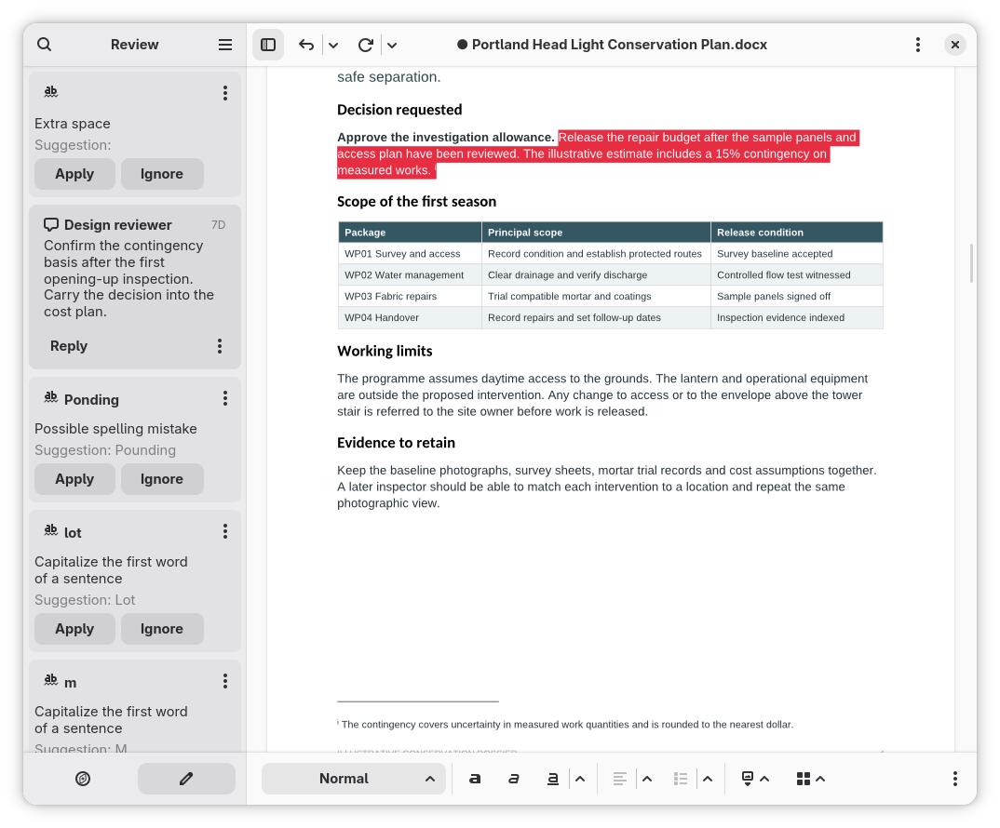
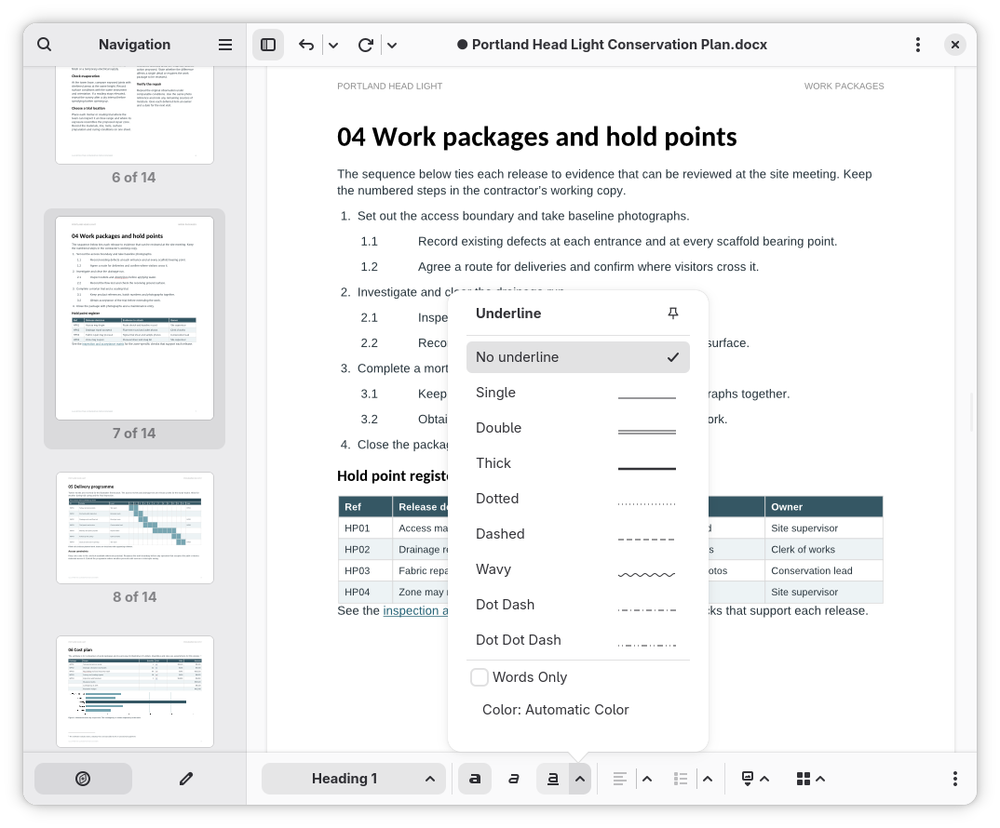

# Leaf

**Powerful documents. A clear workspace.**

Leaf brings advanced word processing to a native GNOME interface. Create richly formatted reports, navigate long documents and review changes, with everyday tools close at hand and detailed options when you need them. Keep your attention on your work.

## More than a blank page

- **Build substantial documents:** DOCX and ODT editing, styles, tables, multilevel lists, images and basic equations.
- **Shape the page:** columns, page margins, headers, footers, page numbers and floating images with text wrapping.
- **Keep long documents manageable:** page thumbnails, heading navigation, bookmarks and movable heading sections; automatic contents, numbered captions and cross-references in DOCX.
- **Review in context:** spelling and grammar suggestions, comments with replies, and tracked changes in a dedicated sidebar.
- **Make the workspace yours:** a configurable bottom toolbar, detailed native formatting menus, tabs, light and dark appearance, and English and Spanish interfaces.
- **Finish and share:** personal templates, search and replace, autosave and recovery, PDF export and printing.

## See Leaf in action

### Find your way through complex layouts

Heading navigation alongside columns and an image with text wrapping.

### Review without losing context

Comments and language suggestions beside the document, with a formatted table and a footnote on the page.

### Go deeper when you need to

Detailed formatting in a native menu, here showing underline styles alongside a multilevel list and table.

*[Real application captures supplied and approved by the maintainer. Capture details and photograph credits](docs/screenshots/README.md).*

## The power behind the interface

[WordCraft](https://github.com/storytold/wordcraft) provides the document engine: editing, layout, rendering and file formats. It offers many of the advanced capabilities familiar from Microsoft Word. Leaf brings that foundation into a simpler GNOME workspace, exposing more of it as each feature is integrated and tested. This is not a claim of full Microsoft Office feature parity or perfect file compatibility.

## Help it grow

Real-document testing and review by experienced developers are welcome. Automated tests do not establish complete compatibility, accessibility or comprehensive human code review. [AI assistance and validation limits](docs/AI_ASSISTANCE.md).

Contributors: work on [`main`](https://github.com/frandavid100/leaf/tree/main). [Build and contribute](CONTRIBUTING.md) · [Roadmap](ROADMAP.md) · [Release notes](docs/RELEASE_NOTES.md)

## Try Leaf

[Linux installation](docs/INSTALLING.md) · [Flatpak download](https://github.com/frandavid100/leaf/releases/tag/v0.1.0-alpha.44) · [Experimental Windows version](https://github.com/frandavid100/leaf/releases/tag/v0.1.0-alpha.44-windows.1)

**Linux:** install from [FlatPark](https://flatpark.org/apps/io.github.frandavid100.leaf/) to receive updates through your Flatpak software manager. You can also download the standalone `.flatpak` from [GitHub Releases](https://github.com/frandavid100/leaf/releases); those bundles are updated manually. [Installation instructions](docs/INSTALLING.md).

**Windows:** an [experimental installer and portable ZIP](https://github.com/frandavid100/leaf/releases/tag/v0.1.0-alpha.44-windows.1) are available. Windows releases are occasional and unsigned. [Installation and limitations](docs/WINDOWS.md).

**Leaf is in alpha. Use copies of important documents.** Complex document compatibility is still being tested, and some advanced features require DOCX. Leaf blocks ODT saves that would lose supported document structures. [Current capabilities and limitations](PROJECT_STATUS.md).

[Report a problem](https://github.com/frandavid100/leaf/issues/new/choose) · [Testing guide](docs/TESTING.md) · [Help translate on Weblate](https://hosted.weblate.org/projects/leaf/application/) · [Translation guide](docs/TRANSLATING.md)

## Development with AI

**Built through vibe coding with ChatGPT/Codex.** The maintainer designs the application and tests builds; AI agents write much of the native interface, tests and packaging. [How Leaf is developed](docs/AI_ASSISTANCE.md).

Leaf is an independent project, not an official GNOME application. Free software under [GPL-3.0-or-later](LICENSE).
