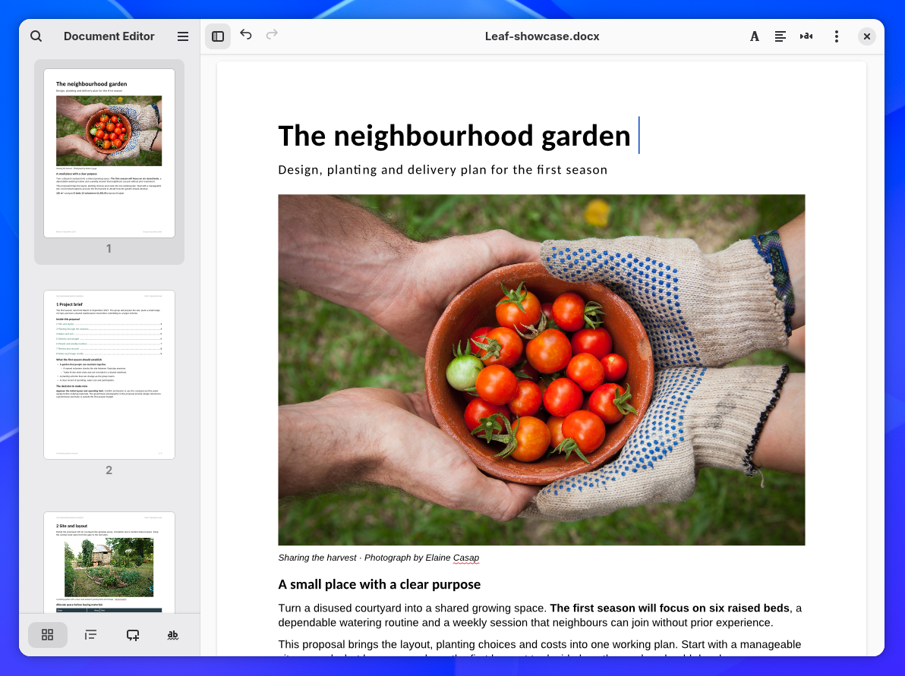

# Leaf

**Powerful word processing, designed for GNOME.**

Leaf is a word processor for Linux with a native GNOME interface. Its goal is to make advanced document editing straightforward: everyday tools within reach, detailed options when you need them, and an uncluttered workspace that keeps your document at the centre.

**[Try the Flatpak alpha](https://github.com/frandavid100/leaf/releases)** · [Installation](docs/INSTALLING.md)

*[Screenshot details and photograph credit](docs/screenshots/README.md).*

## Write and organise

- Edit DOCX and ODT files with styles, tables and inline images.
- Arrange pages with columns, headers, footers and page numbers.
- Navigate by thumbnails, headings and bookmarks; search, replace, review spelling and add comments.
- Work across tabs and windows, configure autosave and recovery, then export to PDF or print.

English and Spanish interfaces, with light and dark appearance.

## The power behind the interface

[WordCraft](https://github.com/storytold/wordcraft) provides Leaf's document engine. Its [documented capabilities](https://github.com/storytold/wordcraft/blob/165d5725dc25b4a7887d8025c3b1fe506ccc3dcc/README.md#what-works-today) include advanced tools familiar from Microsoft Word, such as footnotes, bibliographies, tracked changes and mail merge.

The aim is to bring more of that power into GNOME while keeping the interface simple. Leaf currently exposes part of the engine's functionality; additional features need integration and testing.

## Try it and help it grow

Download the x86_64 `.flatpak` from [Releases](https://github.com/frandavid100/leaf/releases) and open it with GNOME Software. Updates are currently installed manually.

**Leaf is in alpha.** Test with copies of important files: complex document compatibility is still being tested, and comments and category metadata require DOCX.

[Known limitations](PROJECT_STATUS.md) · [Testing guide](docs/TESTING.md) · [Report a problem](https://github.com/frandavid100/leaf/issues/new/choose) · [Help translate](docs/TRANSLATING.md)

## Development with AI

Much of Leaf's native interface code was generated by AI agents. The maintainer directs the design, chooses features and tests builds; implementation is largely delegated to those agents. Tests, packaging, documentation and original icon artwork have also used AI tools. [Scope and validation limits](docs/AI_ASSISTANCE.md).

Contributors: work on [`wordcraft-saving`](https://github.com/frandavid100/leaf/tree/wordcraft-saving). [Build and contribute](CONTRIBUTING.md) · [Roadmap](ROADMAP.md) · [Release notes](docs/RELEASE_NOTES.md)

Leaf is an independent project, not an official GNOME application. Free software under [GPL-3.0-or-later](LICENSE).
