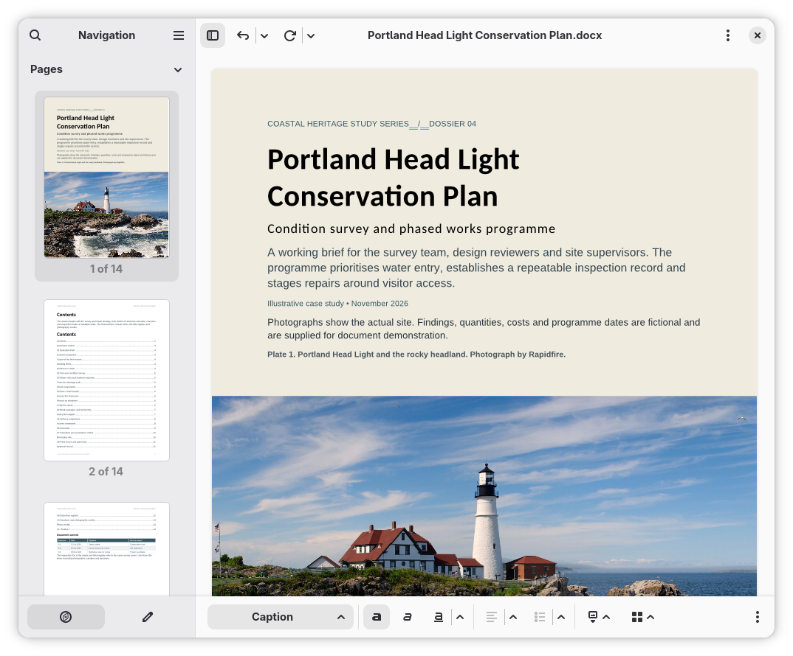
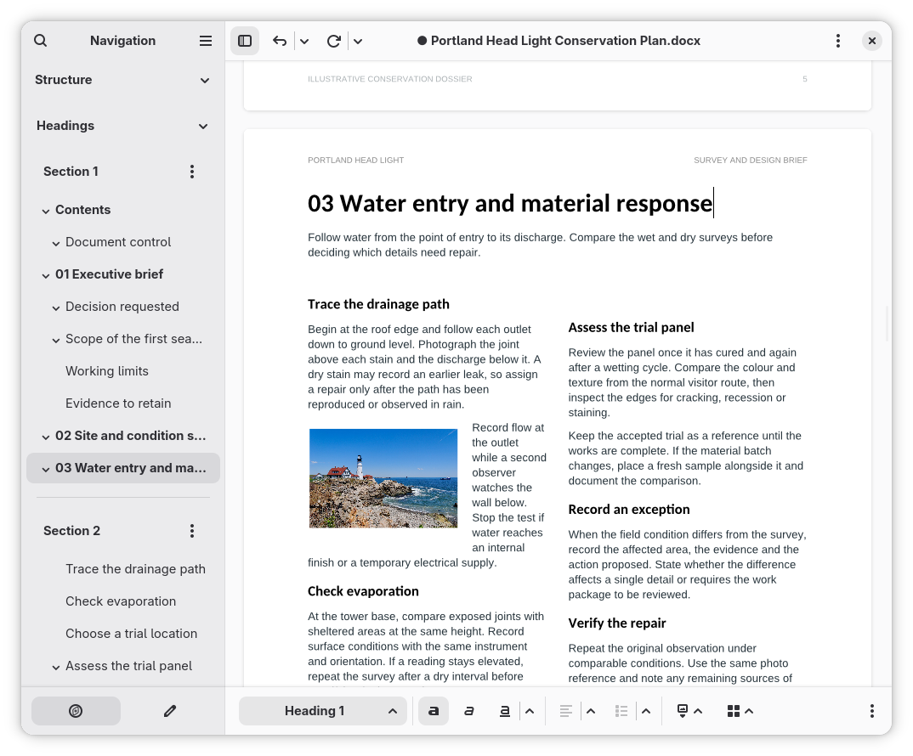
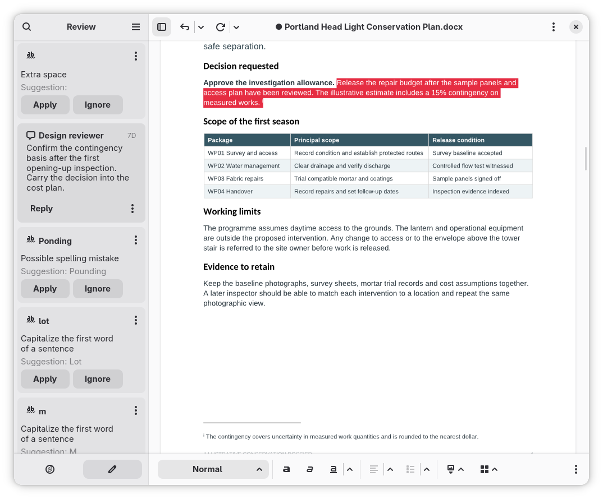
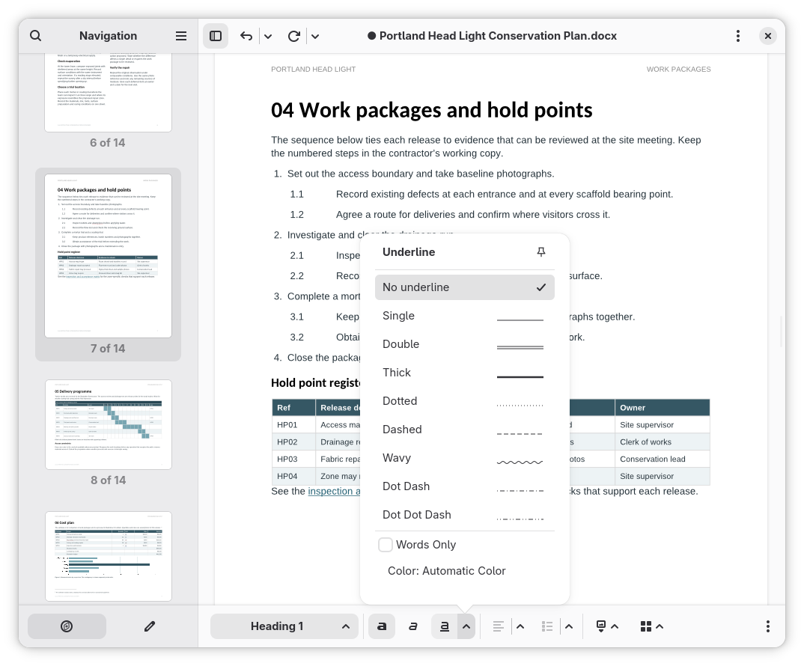

# FlatPark gallery refresh — 11 November 2026

## Scope and status

David asked to resume the FlatPark listing after supplying and approving four
current screenshots. Upstream AppStream now references the same unretouched
images as the README. The FlatPark fork branch is
[`fix/leaf-gallery-2026-11`](https://github.com/frandavid100/flatpark/tree/fix/leaf-gallery-2026-11).
The branch includes the gallery, icons, release-note backfill and revised copy.
[Compare the three changed files](https://github.com/flatpark/flatpark/compare/main...frandavid100:flatpark:fix/leaf-gallery-2026-11).
It is prepared for review; no new FlatPark PR has been opened and the public
catalogue has not been refreshed by this work.

FlatPark main baseline: `b97446f9361ad5c380a2dee400b480ee7d75c4d9`.
Packaged version: **0.1.0-alpha.44**, already pinned by FlatPark. The existing
English/Spanish product description is renewed to follow the README, at David’s
request. Approved light/dark branding colours are kept.

## Revised product description

The following is the product copy. FlatPark’s existing packaging/permission
paragraphs remain appended unchanged in its registry metainfo.

### Español

Leaf reúne herramientas avanzadas de edición en una interfaz sencilla e integrada en GNOME. Crea informes con una maquetación cuidada, recorre documentos largos y revisa los cambios, con las herramientas habituales a mano y las opciones detalladas disponibles cuando las necesitas.

- Crea y edita documentos DOCX y ODT con estilos, tablas, imágenes y columnas.
- Recorre documentos largos mediante miniaturas de páginas, títulos y marcadores.
- Añade notas al pie y crea índices automáticos, leyendas numeradas y referencias cruzadas en DOCX.
- Revisa la ortografía, la gramática, los comentarios y el seguimiento de cambios desde un panel lateral.
- Elige las herramientas de tu barra, trabaja con varios documentos en pestañas y utiliza tus propias plantillas.
- Utiliza el autoguardado y la recuperación, y exporta el resultado a PDF o imprímelo.

Leaf está en fase alfa. Pruébalo con copias de los documentos importantes: la compatibilidad sigue mejorando y algunas funciones avanzadas requieren DOCX. Leaf bloquea el guardado en ODT cuando detecta estructuras que todavía no puede conservar.

Leaf utiliza el motor de documentos WordCraft. Buena parte de su interfaz nativa, pruebas y empaquetado se ha producido mediante vibe coding con ChatGPT/Codex; el icono también se ha creado con asistencia de IA.

### English

Leaf brings advanced word processing to a simple, native GNOME interface. Create richly formatted reports, navigate long documents and review changes, with everyday tools close at hand and detailed options when you need them.

- Create and edit DOCX and ODT documents with styles, tables, images and columns.
- Find your way through long documents with page thumbnails, headings and bookmarks.
- Add footnotes, and build automatic contents, numbered captions and cross-references in DOCX.
- Review spelling, grammar, comments and tracked changes in a dedicated sidebar.
- Choose the tools on your toolbar, work across tabs and start from your own templates.
- Use autosave and recovery, then export to PDF or print.

Leaf is in alpha. Test with copies of important documents: compatibility is still being improved, and some advanced features require DOCX. Leaf blocks ODT saves when it detects structures it cannot yet preserve.

Leaf uses the existing WordCraft document engine. Much of Leaf’s native interface, tests and packaging was produced through vibe coding with ChatGPT/Codex; the icon also used AI assistance.

## Gallery

All four files are 1074 × 890 PNG RGBA screenshots with transparent outer
margins, real compositor shadow and native rounded corners. They retain their
original bytes and are referenced at immutable Leaf commit
`233d5b9c1e0201c55c79c62ec8b6a56c12970b2c`.
[Original attachments, hashes and photograph credits](screenshots/README.md).
The exact build and display scale were not recorded; they are not asserted as
release-specific test evidence.

### 1. Cover — default image

Create illustrated documents with page previews. / Crea documentos ilustrados
con miniaturas de páginas.

### 2. Layout and navigation

Navigate long documents with columns and text wrapping. / Recorre documentos
largos con columnas y texto alrededor de imágenes.

### 3. Review

Review comments and language suggestions in context. / Revisa comentarios y
sugerencias de idioma junto al documento.

### 4. Detailed formatting

Use detailed formatting tools when you need them. / Accede a opciones de formato
detalladas cuando las necesites.

## Prepared PR draft

**Title:** `fix(leaf): refresh approved gallery, icons and release notes`

Leaf (`io.github.frandavid100.leaf`) has a current alpha.44 archive pin, but its
store gallery and exported icons still show the earlier interface/branding.
The latest four registry release entries also have empty descriptions.

**What:** replace the four alpha.28 images with the maintainer's approved gallery,
using immutable upstream URLs and English/Spanish captions. Copy the current
upstream blue-quill full-colour and symbolic SVG icons. Fill the existing empty
alpha.44, .42, .41 and .40 release entries from the reviewed upstream alpha.44
metainfo. Rewrite the English/Spanish product description around advanced editing
with a simple GNOME workspace, followed by concrete capabilities and then the
alpha and AI disclosures. Keep branding colours and FlatPark's
distribution/permissions paragraphs.

**Packaging and sandbox:** the official alpha.44 extra-data URL, digest and size,
GNOME 51 runtime, manifest, desktop entry, wrappers, permissions, resolver and
shared automation are unchanged. No version bump or application binary release.
This is an upstream-maintainer presentation update, prepared with AI assistance.
Leaf is not on Flathub.

**Tested:** upstream's 16 Python tests, reviewed-news generation and project links;
FlatPark descriptor parsing/audit and the update-pins regression suite; PNG
integrity, dimensions and alpha channel; SVG rendering; exact icon identity and
preservation of package fields. [Metadata CI for the revised copy](https://github.com/frandavid100/leaf/actions/runs/42975267698) passed, including AppStream, gettext compilation, screenshot URLs and the 16 Python tests.
No local Flatpak build/install/launch or installed-store-client inspection was
performed in this environment. The AppStream CLI is not installed locally;
its validation is delegated to the existing upstream metadata CI and FlatPark CI.

Please publish the presentation update after review. Future release notes remain
a separate maintainer-owned resolver change, as discussed in
[PR #1074](https://github.com/flatpark/flatpark/pull/1074#issuecomment-6729671898).
This PR intentionally changes only three data files in Leaf's registry directory.

## Validation record and remaining acceptance

- Local metadata/news checks, 16 Python tests and project links: passed.
- FlatPark descriptor parse/audit and update-pins regressions: passed. The
  AppStream-specific regression branch self-skips without appstreamcli.
- [Revised description metadata CI](https://github.com/frandavid100/leaf/actions/runs/42975267698): passed for `3de570d91fe54129a9485ccdc708dfa5fa009e0c`. AppStream validation, complete English/Spanish catalogs, screenshot URLs, 16 Python tests, reviewed news and documentation links passed.
- The prepared FlatPark branch now ends at `e9a77e8cb70e2eb3d0e0e269b778ad6dab234854`.
- No new Leaf executable, release/tag mutation, runtime or permission changes.
- FlatPark requires explicit human OK before opening a PR, under its
  [packaging playbook](https://github.com/flatpark/flatpark/blob/main/docs/packagers/playbook.md).
- After maintainer publication: refresh the actual FlatPark origin in Bazaar
  and inspect all four images, transparent margins/shadow on light/dark gallery
  backgrounds, blue icon, translated description and alpha.44 news. The website
  may show cached metadata before its own build catches up.
- Keep [Leaf #185](https://github.com/frandavid100/leaf/issues/185) open until the
  published catalogue/client check succeeds. A prepared branch or merged PR
  is not proof of the final rendering.
