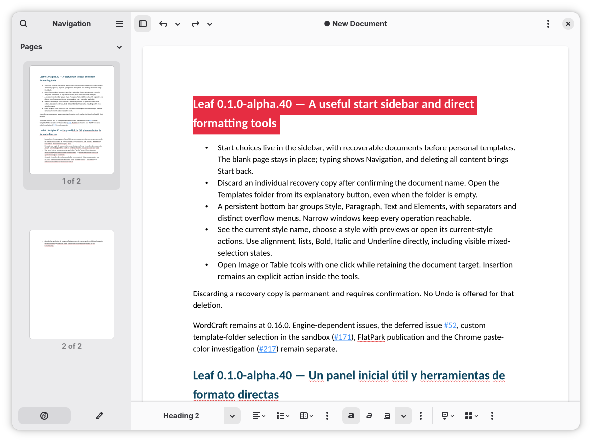
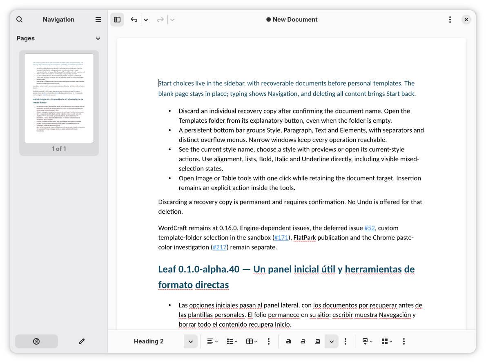
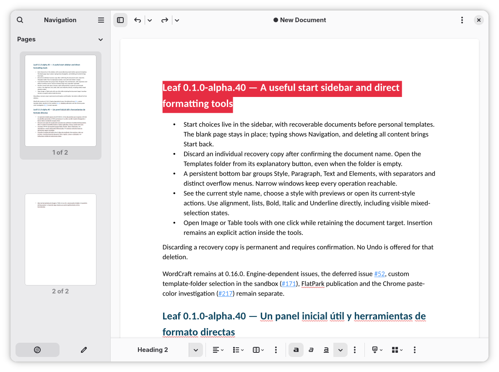
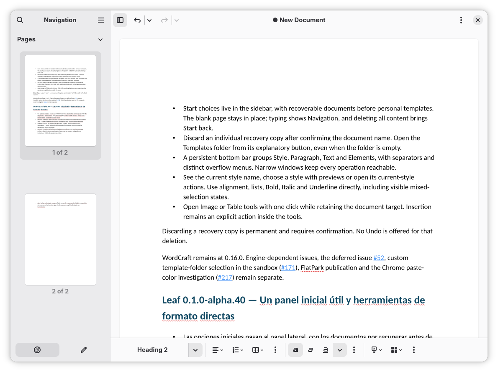
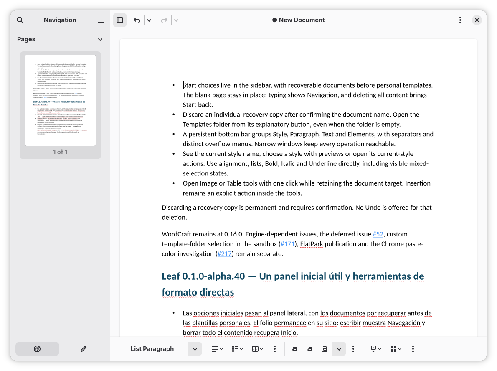

# Issue #152: maintainer RC trial, 2026-11-09

Five original screenshots supplied by David, preserved without image edits.
See [issue #152](https://github.com/frandavid100/leaf/issues/152) for the two
reported selection/deletion routes and expected behavior. The document contains
alpha.40 release notes; that text is document content, not the running app's
version dialog. The visible selection highlight alone does not establish the
engine range or whether its paragraph mark is included.

## Original image(20261109-204759).png

## Original image(20261109-204916).png

## Original image(20261109-204929).png

## Original image(20261109-205007).png

## Original image(20261109-205016).png

